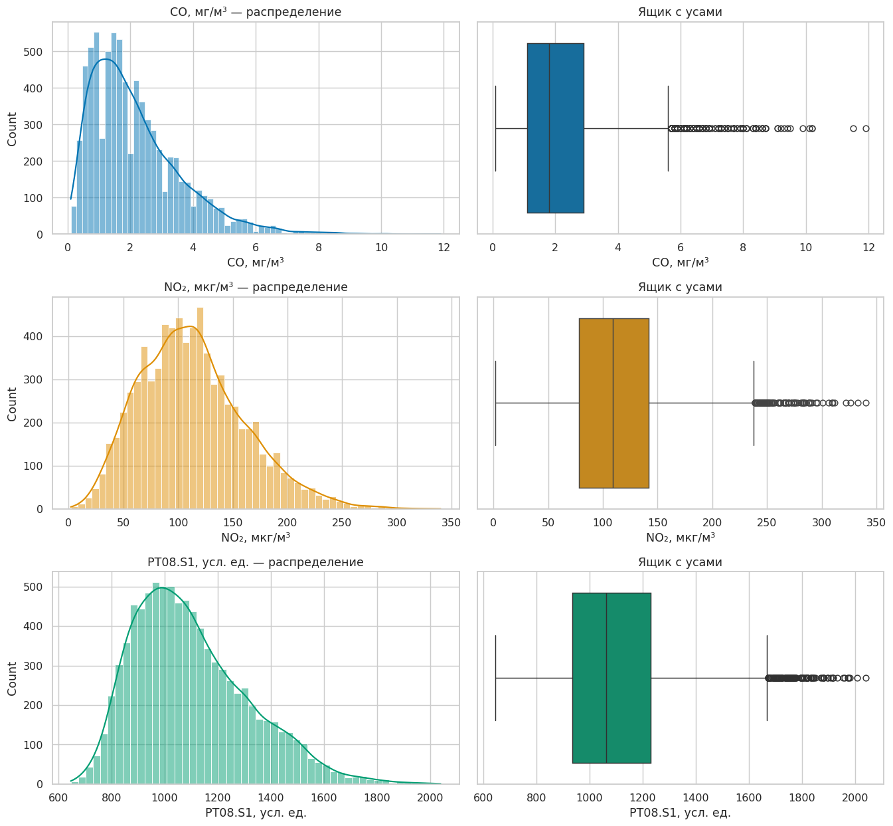
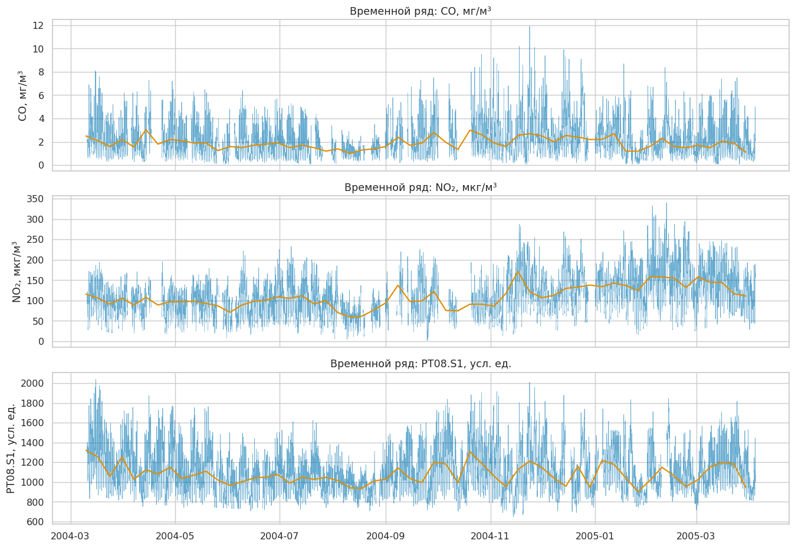
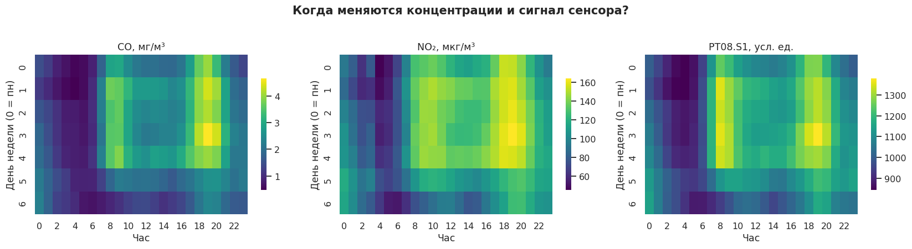
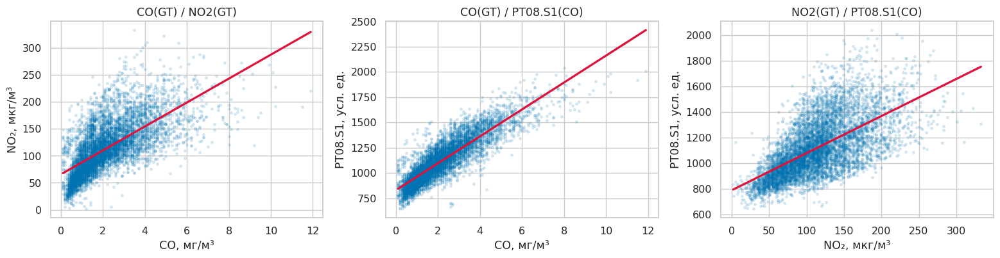
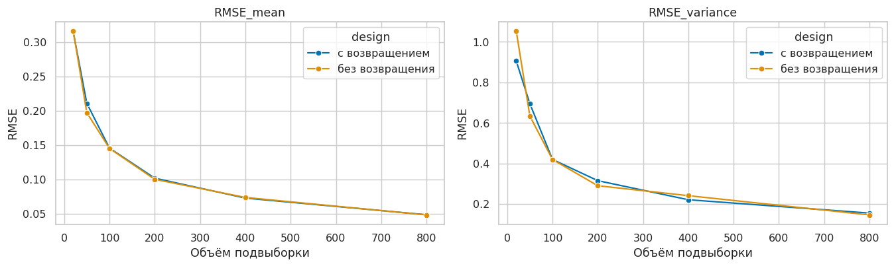
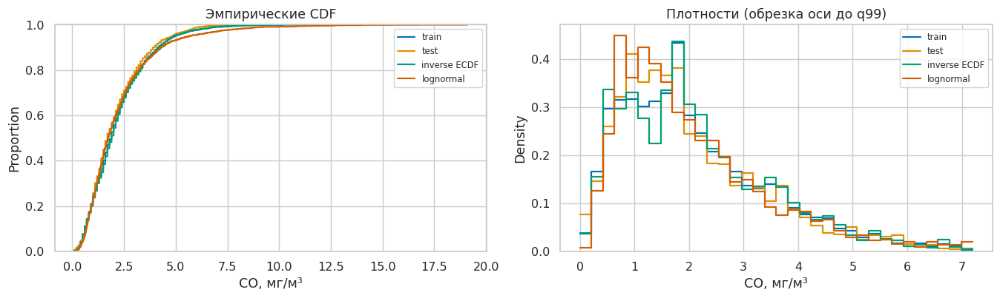

# Lab01 — ИнфоХимия | Химические газовые сенсоры

**Статистическое исследование концентраций CO и NO₂ и отклика газового сенсора PT08.S1(CO).**

Два спринта: анализ случайных величин, проверка зависимостей и статистических гипотез, состоятельность оценок, генерация случайных измерений и сравнение с реальными данными.

**Основные материалы:** [Jupyter Notebook](Lab01_InfoChem_Gas_Sensors.ipynb) · [HTML-отчёт с графиками](Lab01_InfoChem_Gas_Sensors_Beautiful_Report.html) (для просмотра скачайте и откройте в браузере).

## 1. Исследование данных

**Данные:** UCI Air Quality (Италия, 2004–2005); дополнительный датасет — Beijing Multi-Site Air Quality.

## 2. Временная динамика

## 3. Связь случайных величин

Используются корреляции Пирсона и Спирмена, перестановочные проверки и поправка Холма для множественных сравнений.

## 4. Состоятельность оценок

## 5. Генератор случайных чисел

В ноутбуке приведены математическое обоснование, проверка метрик и автотесты генератора, а также обзор дополнительных алгоритмов.

---

**Запуск:** откройте `.ipynb` в Google Colab и выберите «Среда выполнения → Выполнить все». Ноутбук использует открытые источники данных и библиотеки Python, перечисленные в ячейках импорта.

*Примечание: если GitHub не отображает сам `.ipynb`, графики можно посмотреть прямо в этом README или в HTML-отчёте после скачивания.*
